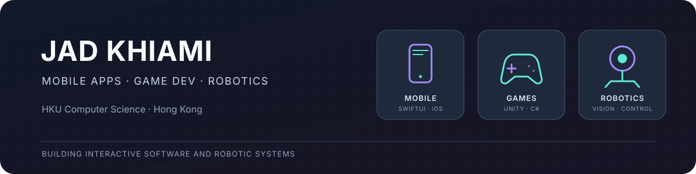

  

## ✨ About me

I'm an HKU Computer Science student in Hong Kong who builds across **mobile apps, games, and robotics**. My projects range from native SwiftUI apps and Unity experiences to robot perception and control. I enjoy taking ideas through implementation, testing, and clear documentation.

## 🧰 Tech stack

**📱 Mobile development**

  

**🎮 Game development**

 

**🤖 Robotics and computer vision**

     

## 🚀 Selected projects

| Area | Project | What it is |
| --- | --- | --- |
| 📱 Mobile | [Pokfu](https://github.com/Lavalx100/Pokfu) | A native SwiftUI iOS/iPadOS Moodle companion with course and deadline views, calendar planning, reminders, widgets, and a Live Activity. |
| 🎮 Games | [Last Light: HKU](https://github.com/Lavalx100/last-light-hku) | A first-person Unity exploration game set in a recreation of HKU's Main Building, with four console mini-games and a downloadable macOS build. |
| 🤖 Robotics | [Visual servoing in MuJoCo](https://github.com/Lavalx100/visual-servo-mujoco) | Camera-based reaching and manipulation experiments with demos, benchmarks, tests, and documented limitations. **Simulation study; no real-robot performance claim.** |

## 🤝 Open-source contributions

**Merged**

- [Hesai LiDAR SDK #75](https://github.com/HesaiTechnology/HesaiLidar_SDK_2.0/pull/75) — avoid redefining the system `BOTHER` baud-rate flag.

**Open pull requests**

- [LeRobot #4882](https://github.com/huggingface/lerobot/pull/4882) — derive video timestamps from frame indices.
- [LeRobot #5005](https://github.com/huggingface/lerobot/pull/5005) — load native RealSense JSON presets. Physical-camera preset application has not been tested.
- [Hesai ROS 2 #120](https://github.com/HesaiTechnology/HesaiLidar_ROS_2.0/pull/120) — publish the JT128 confidence byte in point clouds.
- [Galbot MCAP → LeRobot #2](https://github.com/GalaxyGeneralRobotics/galbot-mcap2lerobot/pull/2) and [#3](https://github.com/GalaxyGeneralRobotics/galbot-mcap2lerobot/pull/3) — faster timestamp matching and fail-safe batch conversion.

## 📊 GitHub stats

  
  

  

The language card summarizes code volume in eligible public repositories; it excludes forked repositories and is not a measure of skill. The cards are served by third-party services and may be cached or temporarily unavailable.

 

  <a href="https://github.com/Lavalx100">GitHub</a> ·
  <a href="https://github.com/Lavalx100/Pokfu">Mobile app</a> ·
  <a href="https://github.com/Lavalx100/last-light-hku">Game</a> ·
  <a href="https://github.com/Lavalx100/visual-servo-mujoco">Robotics project</a>

